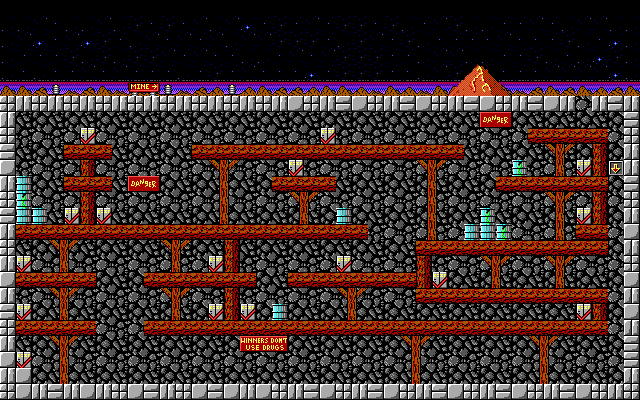
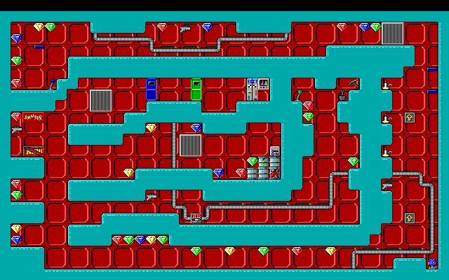

# Crystal Caves Episode 1 — C / WebAssembly port

A clean-room, decompilation-driven port of the 1991 shareware **Crystal Caves
Episode 1** (Apogee Software) to freestanding C and WebAssembly.  There is no
DOSBox and no emulator in the loop: the original EXE was disassembled, the game
logic was re-implemented in C, and every subsystem is verified **frame-for-frame**
against the real binary running under a Unicorn-based oracle.

> [!TIP]
> **Play it now in your browser:** <https://crystal-caves.re-cycledair.com>




The goal is fidelity, not a remake:

- static level rendering is **pixel-exact on all 19 levels**;
- player physics, combat, cell events, all 46 handler behaviours and level
  transitions are verified frame-for-frame against the original EXE;
- the HUD, text windows, shell flow, high scores, save format, key handling and
  all 36 sound effects follow the original routines;
- saves, high scores, key bindings and config use `localStorage`.

The original game binary and shareware data are not downloadable here.
`extracted/` and `out/portable/` are committed, so a fresh checkout builds and
runs without the original archive.  Crystal Caves is © Apogee Entertainment;
see [License](#license) for the scope of this project's own code.

## Quick start

```sh
cd wasm
make                    # copies assets and builds render.wasm (~155 KB)

python3 -m http.server 8080
# open http://localhost:8080/game.html
```

The page fetches the wasm module and asset files, so it must be served over
HTTP — opening `game.html` from `file://` will not work.

Nothing installed locally, or building on Windows?  Every command in this
README also runs in the dev container — see
[Develop in Docker](#develop-in-docker-any-platform).

## Develop in Docker (any platform)

Windows hosts, and any machine without a local LLVM/Node/Python toolchain, can
run everything in a container instead of installing the requirements below:

```sh
docker compose build                                    # once, from the repo root
docker compose run --rm dev make -C wasm clang          # build render.wasm
docker compose run --rm dev make -C wasm test-all        # full regression suite
docker compose run --rm dev make -C wasm test-browser    # Playwright smoke test
docker compose run --rm dev make -C wasm test-oracle-physics   # Unicorn fixtures
docker compose run --rm dev make -C wasm perf lint
docker compose run --rm dev bash                        # interactive shell
docker compose up web                                   # http://localhost:8080/game.html
```

`compose.yaml` builds `docker/Dockerfile.dev`: Debian `clang` + `lld`, Node.js 22
(same as CI), a `capstone`/`unicorn` virtualenv at `/opt/cc1/venv`, and Playwright
Chromium — i.e. every target in the Requirements table, with nothing to install on
the host.  The image exports `LLVM`, `PYTHON`, `NODE_PATH` and
`PLAYWRIGHT_BROWSERS_PATH`, which override the Makefile's Homebrew defaults, so no
target needs `LLVM=...` inside the container.  The checkout is mounted at `/src`
and build outputs (`wasm/render.wasm`, `wasm/assets/`) land in your working tree
as usual, so the wasm you just built is the wasm the browser serves.

The first build pulls a base image, the toolchain and Chromium: a few minutes
and about 2.5 GB.  After that it is cached and only rebuilds when
`wasm/package.json`, `wasm/package-lock.json` or `tools/requirements.txt`
change.  Inside the container a full rebuild takes ~3 s and the whole
`make test-all` suite about 10 s, so the container is not the slow part.

Two notes for Windows users:

- `.gitattributes` pins makefiles and shell scripts to LF.  A checkout made
  before it existed may hold a CRLF `wasm/Makefile`, which GNU make inside the
  container misreads (the dev container warns when it sees one).  git reports
  such a file as clean, so a plain `git checkout` will not rewrite it: delete it
  once and git re-checks it out as LF,
  `rm wasm/Makefile && git checkout -- wasm/Makefile`.
- The container runs as uid 1000, so files it writes stay usable from the host.

This is the **development** image.  The root `Dockerfile` is a separate, much
smaller production image (nginx, no toolchain, no test data) — see
[Deploy with Dokku](#deploy-with-dokku).

## Requirements

| Purpose | Requirements |
|---|---|
| Build | Homebrew LLVM **and lld** on macOS (`brew install llvm lld`), or `clang` + `lld` on Linux |
| Tests | Node.js 18+ and Python 3.9+ (stdlib only) |
| Oracle regeneration | Python venv with `tools/requirements.txt` (`capstone`, `unicorn`) |
| Browser smoke test | npm + `playwright` (test-only; see `wasm/package.json`) |
| None of the above locally | Docker Desktop (Windows) or Docker 20.10+ — see [Develop in Docker](#develop-in-docker-any-platform) |
| Production image | Docker 20.10+ (multi-stage build; no local toolchain needed) |

There is no Homebrew on Windows, and the build is not portable to MSVC: on
Windows use the dev container above, or `clang`/`lld` inside WSL.

The Emscripten build (`make emcc`) additionally needs `emcc` on `PATH`; it is a
secondary back-end and is not exercised by CI.

## Build

```sh
cd wasm
make                    # same as: make clang
```

This copies the portable assets from `../out/portable/` into `wasm/assets/` and
produces `wasm/render.wasm` (about 155 KB at `-Oz`).  Without a local LLVM, the
same build is `docker compose run --rm dev make -C wasm clang`.

`wasm/play.html` is a developer level-select harness.  `wasm/index.html` is a
minimal renderer smoke page.  `make social-card` regenerates
`wasm/social-card.png` (1200x630) from the original title screen for link
previews.

## Controls

Defaults follow the original DOS bindings, with Space and Up Arrow added as
browser jump aliases:

| Action | Key |
|---|---|
| Move | Left/Right arrows |
| Jump | Ctrl (DOS default), Space or Up Arrow |
| Fire / action | Alt |
| Help | Esc or F1 |
| Pause | P |
| Fullscreen | Fullscreen button (Esc exits) |

Bindings can be redefined from the in-game help screen and are persisted.
Joystick support uses the Gamepad API and is off by default.

On macOS, holding Ctrl and pressing Left/Right triggers the system Spaces
shortcut. Use Space or Up Arrow to jump when steering through the air with
arrow keys.

### Touch controls

On phones and tablets the page adds a semi-transparent virtual pad: ◀ ▶ at the
bottom left and JUMP/FIRE at the bottom right. A soft-keyboard strip (Esc,
Enter, Help, Pause) stays visible in menus and text entry, and a compact
on-screen keyboard slides up for save slots and high-score name entry.
Tapping the canvas advances the read-only "any key" screens (logo, story,
messages, pause, high scores, ending).

The controls auto-detect a coarse pointer and can be toggled from the button
next to Fullscreen. The choice is remembered in `localStorage`
(`cc1.touch.v1`), separate from the `CC1.CFG`-equivalent config.

On iOS Safari, where the element Fullscreen API is unavailable, the button
becomes an **Immersive** toggle that hides the page chrome. Adding the page to
the Home Screen (via `manifest.webmanifest`) gives a chromeless standalone app.

Known limits: iOS mutes WebAudio when the ringer switch is on; the in-browser
URL bar cannot be hidden on iOS (use Add to Home Screen); key redefinition on
touch uses the on-screen keyboard keys only.

### Browser substitutions

DOS file I/O, BBS dialling and ordering are replaced by the original text
screens with no external calls.  Saves (slots 0–9), the ten-row high-score
table and `CC1.CFG`-equivalent settings live in `localStorage`; see
`notes/persist.md` for the format and validation rules.  The server is
therefore completely stateless — all player progress stays in the browser.

## Deploy with Dokku

The repo ships a `Dockerfile` that builds the wasm module with Debian
`clang`/`lld` and serves it from `nginx:alpine`.  This is the **production**
image — small, no toolchain, no test data; `docker/Dockerfile.dev` is the
separate development toolchain image described in
[Develop in Docker](#develop-in-docker-any-platform).  Only `game.html`, its
browser scripts (`game.js` plus `game/*.js` and the small adapters), the
favicon set, the link-preview card, `render.wasm` and `assets/` are copied into
the runtime image; no toolchain, test data or original EXE is present in the
result.  That is about 1.6 MB of game files on top of `nginx:alpine` (≈65 MB
total).

Dokku auto-detects the root `Dockerfile` and needs no ports configured: the
image exposes `80`, so the host's nginx proxies straight to it.

```sh
# once, on the Dokku host
dokku apps:create crystal-caves

# once, in this checkout
git remote add dokku dokku@your-host:crystal-caves

# every deploy
git push dokku main
```

The app is then available at the default vhost (`http://crystal-caves.your-host/`).
Add `dokku letsencrypt:enable crystal-caves` on the host for HTTPS.  There are
no environment variables, volumes, migrations or background processes.

Build and run the image locally the same way CI would:

```sh
docker build -t crystal-caves .
docker run --rm -p 8080:80 crystal-caves
# open http://localhost:8080/
```

## Tests

Run from `wasm/`:

```sh
make test-all           # full committed-fixture regression suite
make test-exports       # built wasm exports match the Makefile EXPORTS list
make test-digest        # golden-master state/view/sound digests
make test-browser       # headless Chromium smoke test (Playwright)
make perf               # wasm size + frame-budget measurement
make lint               # source-size guardrail report (`lint-strict` fails)
```

On a host without the toolchain installed, the same targets run in the dev
container: `docker compose run --rm dev make -C wasm test-all` (see
[Develop in Docker](#develop-in-docker-any-platform)).

`make test-all` needs no virtualenv and no Unicorn: every fixture is committed
under `notes/`.  It covers rendering, physics, combat, handlers, transitions,
cells, HUD/text/messages, the ordering/foreign/BBS/about/video/quit screens,
shell, save/restore, high scores, key mapping, sound, the exact title/credits
scroll (`test-shell-flow`), the input cursor animation (`test-cursor`) and the
refactor digest (`test-digest`).  `notes/regression.md` maps each subsystem to
its target, fixture and harness; `wasm/ARCHITECTURE.md` documents the module
boundaries and the digest-update procedure.

The browser smoke test walks title → intro → hub, drives real keyboard input,
saves and restores through `localStorage`, reloads for config/high-score
persistence and runs the finale flow.  Install its tooling once:

```sh
cd wasm
npm install
npx playwright install chromium
```

Without Playwright, `make test-browser` prints `SKIP` and exits 0.  Inside the
dev container the dependency and its Chromium are already baked into the image,
so the test always runs there.

### Oracle regeneration (optional)

The `test-oracle-*` targets re-run the original routines under Unicorn and
rewrite the committed fixtures, then compare the C port against them.  They
need the Python dependencies and the original unpacked EXE
(`extracted/CC1-UNLZ.EXE`, committed):

```sh
python3 -m venv .venv
.venv/bin/pip install -r tools/requirements.txt
cd wasm
make test-oracle-physics
make test-oracle-combat
make test-oracle-cells
# ... see the Makefile for the full list
```

The dev container already has that virtualenv (`/opt/cc1/venv`, exported as
`PYTHON`), so there the same targets are just
`docker compose run --rm dev make -C wasm test-oracle-physics`.

Regenerating raw extraction from the original archive additionally requires
`CCSW10A.SHR` and is documented in `AGENTS.md`.

## Continuous integration

`.github/workflows/ci.yml` runs on Ubuntu under GitHub Actions or Forgejo
Actions (Forgejo reads `.github/workflows` directly). The workflow has no
`permissions:` block — Forgejo ignores it and grants capabilities through
Authorized Integrations, while the jobs only need the default read token:

- **build + deterministic suite** — apt `clang`/`lld`, `make clang`,
  `make test-all`, `make lint-strict`, then wasm size and frame budget in the
  job summary;
- **headless browser smoke** — `npm ci`, Playwright Chromium,
  `make test-browser`;
- **oracle regeneration** — manual `workflow_dispatch` job with
  capstone/unicorn for re-verifying fixtures.

## Layout

| Path | Contents |
|---|---|
| `wasm/` | C port, build, page shell, JS adapters and tests |
| `notes/` | Recovered routine notes, oracle fixtures and format docs |
| `tools/` | Extraction, oracle emulation, fixture generation and asset export |
| `out/portable/` | Build inputs: levels, GFX, cells, screens, fonts, sound |
| `out/oracle_L*.png` | Committed static render references (19 levels) |
| `extracted/` | Unpacked original EXE and assets |
| `refactor/` | Phased C/WASM refactoring plan |
| `Dockerfile` | Multi-stage wasm build + nginx runtime image (**production**) |
| `docker/Dockerfile.dev`, `compose.yaml` | Development toolchain container: clang/lld, Node 22, capstone/unicorn venv, Playwright Chromium |
| `.gitattributes` | LF pin for makefiles/shell scripts, needed by GNU make in that container |
| `deploy/nginx.conf` | Static host config (MIME, gzip, cache) |

Useful notes: `notes/physics.md` (timing/input), `notes/gameplay.md`
(update loop/handlers), `notes/shell.md` (HUD/text/menu), `notes/persist.md`
(save/config/high-score formats), `notes/sound.md` (driver/traces),
`notes/regression.md` (coverage matrix).

## License

The port's own source — `wasm/`, `tools/`, `deploy/` and the documentation — is
released under the [MIT License](LICENSE).

Crystal Caves is © 1991 Apogee Entertainment.  The original game data,
disassembly inputs and derived renders in `extracted/`, `out/` and the
`assets/` generated from them are included only so the decompilation can be
built and verified, are **not** covered by the MIT license, and remain the
property of their respective owners.  This is a research project, not a
redistribution of the game.
